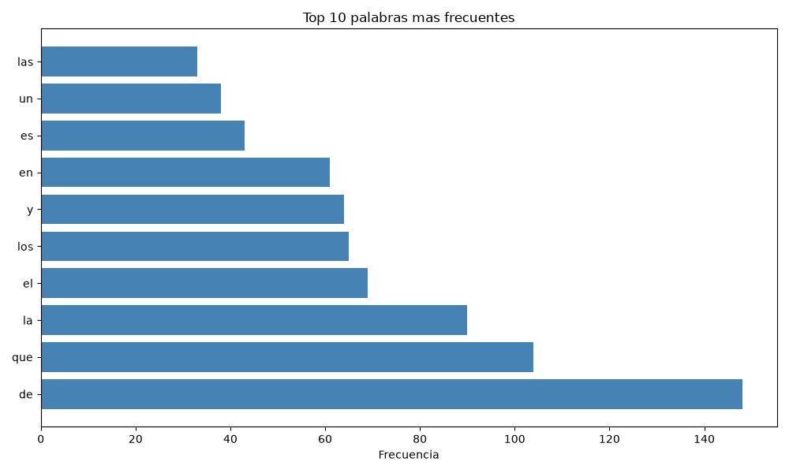
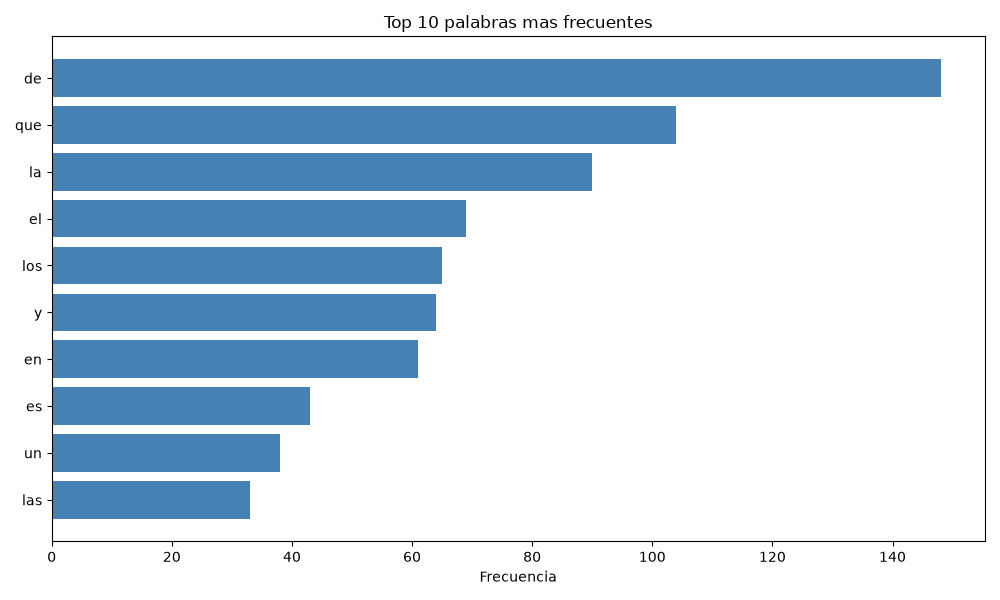
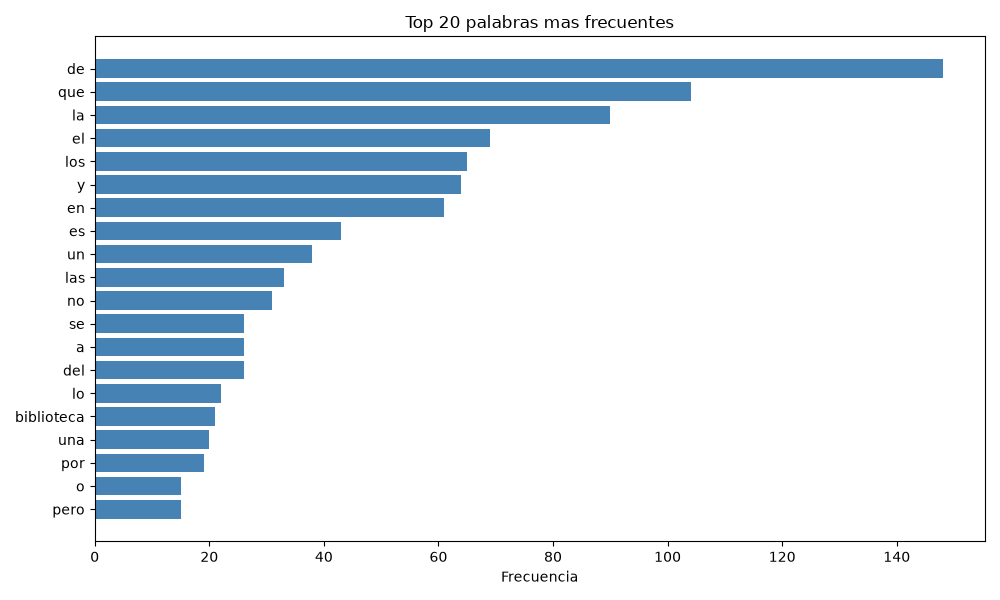
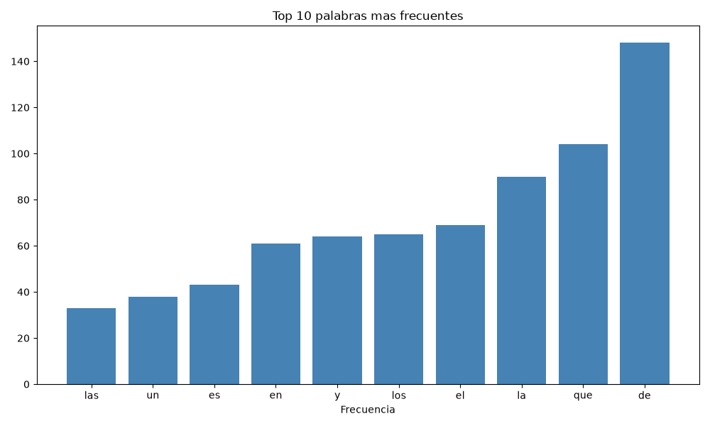

# Informe: Análisis de frecuencia de palabras y visualización

## 1. ¿Por qué el gráfico usa palabras[::-1] y valores[::-1] en lugar de palabras y valores directamente? (Pista: probá sacar el [::-1] y compará el orden de las barras).

La lista `top10` se obtiene ordenando las palabras de mayor a menor frecuencia, por lo que el elemento de índice 0 corresponde a la palabra más frecuente. La función `plt.barh()` dibuja el primer elemento de las listas en la base del eje vertical y los siguientes en sentido ascendente. En consecuencia, si se pasan `palabras` y `valores` sin modificar, la palabra más frecuente queda representada en la parte inferior del gráfico y la menos frecuente en la superior, lo cual invierte el orden esperado de un ranking.

El operador de rebanado `[::-1]` invierte el orden de ambas listas. De este modo, la palabra más frecuente se dibuja en último lugar y queda ubicada en la parte superior, de manera que el gráfico se lee de arriba hacia abajo en orden descendente de frecuencia.

| Variante | Barra inferior | Barra superior |
|---|---|---|
| Sin `[::-1]` | Palabra más frecuente | Palabra menos frecuente |
| Con `[::-1]` | Palabra menos frecuente | Palabra más frecuente |

Al quitar `[::-1]`, el orden de las barras se invierte respecto del gráfico original, tal como indica la pista de la consigna.

Como se observa a continuación, sin `[::-1]` la palabra más frecuente queda en la base del gráfico:

Con `[::-1]`, en cambio, la palabra más frecuente queda en la parte superior:

## 2. ¿Qué pasaría con el gráfico si cambiás top_n=10 por top_n=20? ¿Seguiría siendo legible?

El gráfico seguiría siendo legible, con algunas consideraciones. Al duplicar la cantidad de barras, cada una ocupa menos espacio vertical dentro de una figura de tamaño fijo (`figsize=(10, 6)`). Sin embargo, al utilizar barras horizontales, las etiquetas se mantienen en posición horizontal y siguen pudiendo leerse. Si resultaran muy ajustadas, bastaría con aumentar la altura de la figura (por ejemplo, `figsize=(10, 8)`). El título se actualiza automáticamente, ya que incorpora el valor de `top_n` mediante una cadena formateada.

Desde el punto de vista del contenido, ampliar a 20 palabras aporta menos información útil. El código no filtra palabras vacías (stopwords), por lo que el ranking ampliado incluiría más artículos, preposiciones y conjunciones. Además, las frecuencias de las últimas posiciones tienden a ser similares entre sí, lo que dificulta distinguir diferencias entre las barras.

Como se observa a continuación, con `top_n=20` el gráfico incluye más barras:

## 3. ¿Por qué usar plt.barh() (barras horizontales) en vez de plt.bar() (barras verticales) para este caso?

Las categorías representadas son palabras, es decir, etiquetas de texto de longitud variable. En un gráfico de barras verticales (`plt.bar()`), las etiquetas se ubican bajo cada barra, sobre el eje horizontal, donde compiten por un espacio limitado. Con diez o más palabras, y especialmente si alguna es extensa, las etiquetas tienden a superponerse y es necesario rotarlas, lo que reduce su legibilidad:

En un gráfico de barras horizontales (`plt.barh()`), cada etiqueta se ubica a la izquierda de su barra, sobre el eje vertical, con espacio suficiente y en orientación horizontal. Además, esta disposición reproduce la lectura natural de un ranking, de arriba hacia abajo, y permite comparar las frecuencias a partir de la longitud de las barras. Por estas razones, `plt.barh()` resulta más adecuado para representar rankings de palabras, mientras que `plt.bar()` es preferible cuando las categorías son pocas o breves, o cuando el eje horizontal representa una variable ordenada, como el tiempo.

Con barras horizontales (`plt.barh()`) cada etiqueta cuenta con espacio a la izquierda de su barra:

