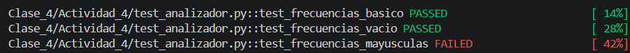
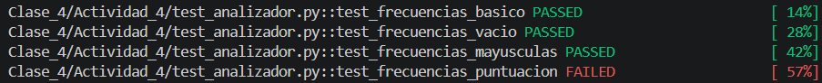
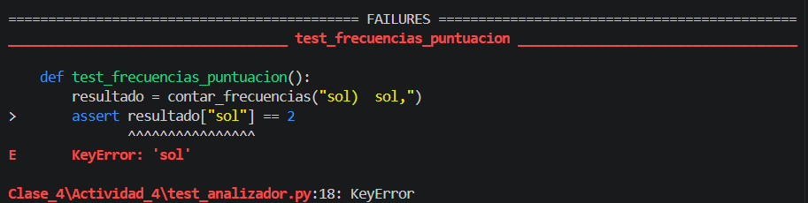

# Informe: Análisis de frecuencia de palabras y pruebas de pytest

## 1. ¿Qué pasaría con test_frecuencias_mayusculas si en analizador.py sacaras el .lower()? Probalo y describí qué mensaje de error muestra pytest.

Si se elimina el método `.lower()` de la función `contar_frecuencias()`, las palabras que presentan diferencias en el uso de mayúsculas y minúsculas se contabilizan como elementos independientes, ya que Python distingue entre ambos casos. Por lo tanto, las variantes «Sol», «sol» y «SOL» se registran como tres palabras diferentes, cada una con una frecuencia de 1.

En consecuencia, el test `test_frecuencias_mayusculas` falla, dado que espera que las tres variantes se contabilicen como una única palabra con una frecuencia de 3. Como se observa en las imágenes, pytest muestra un error de aserción (`AssertionError`), ya que la condición establecida en la prueba no se cumple:

## 2. ¿Por qué contar_frecuencias recibe un string directamente en vez de una ruta de archivo, como en la Clase 2? ¿Qué ventaja tiene eso a la hora de escribir pruebas?

La función `contar_frecuencias()` recibe directamente una cadena de caracteres (string) porque su objetivo es procesar el contenido de un texto, independientemente de su ubicación o formato de almacenamiento. A diferencia de los ejercicios de la Clase 2, no necesita utilizar `with open()` para acceder a un archivo y leer su contenido.

Esta característica presenta una ventaja a la hora de escribir pruebas, ya que permite evaluar el funcionamiento de la función sin necesidad de crear archivos externos, especificar rutas de acceso ni comprobar que los archivos existan y estén correctamente ubicados. De este modo, las pruebas resultan más simples, rápidas y controladas, puesto que permiten concentrarse exclusivamente en verificar que la función cuente correctamente las palabras.

## 3. ¿Se te ocurre algún otro caso de borde para probar (por ejemplo, texto con signos de puntuación, o con espacios de más)?

Se identificaron dos posibles casos de borde para evaluar el comportamiento de la función. El primero consiste en introducir palabras acompañadas de signos de puntuación, por ejemplo, `"sol) sol,"`. En este caso, como se puede notar en las imágenes, la prueba falla porque la implementación actual no elimina los signos de puntuación, por lo que interpreta `"sol)"` y `"sol,"` como palabras diferentes de `"sol"`.

El segundo caso consiste en utilizar espacios en blanco adicionales entre las palabras, por ejemplo, `"sol   sol sol"`. En esta situación, la prueba se ejecuta correctamente, ya que el método `.split()` permite separar las palabras e ignora los espacios adicionales.

Para el código del ejercicio, se decidió incorporar el primer caso como una prueba adicional, con el objetivo de identificar y evidenciar una limitación de la implementación actual. Para que este test se ejecute correctamente, sería necesario modificar la función `contar_frecuencias()` e incorporar un procedimiento de eliminación de los signos de puntuación antes de realizar la separación y el conteo de las palabras.
